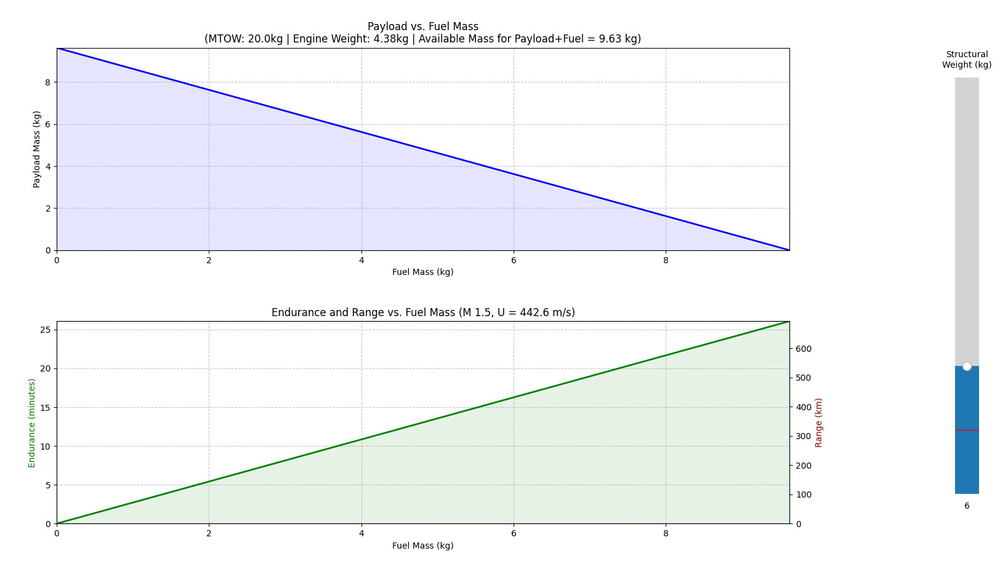
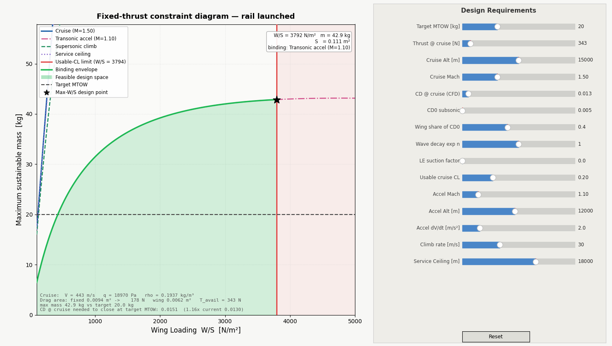
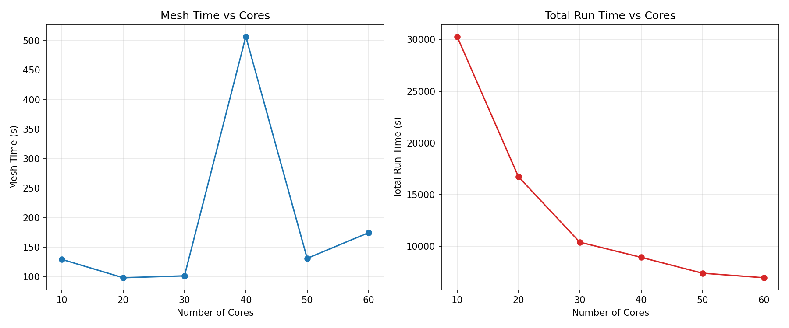
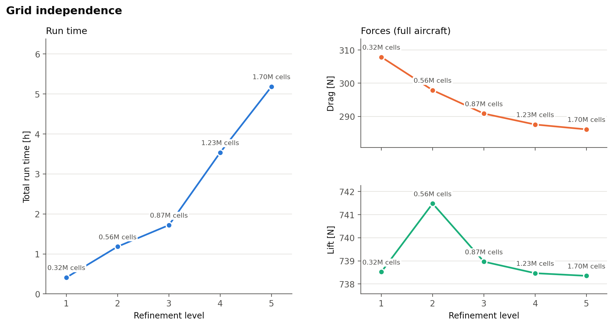
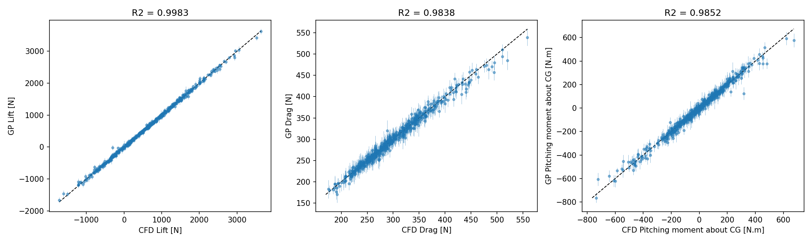

# Aerodynamic Design of a Small-Scale Supersonic UAV Powered by a Rotating Detonation Engine

**Research Project — Aerodynamic Design Focus**  
*Status: In Progress*

---

## Overview

- Goal: aerodynamic design of a 20 kg UAV cruising at **Mach 1.5, 15 km altitude**, powered by an air-breathing rotating detonation engine (RDE).
- Process: engine scaling → weight estimate → constraint analysis → parametric geometry → supersonic CFD setup and verification → design space exploration → surrogate-based optimization → detail design.
- Tools: OpenVSP (geometry), OpenFOAM (CFD), Python / scikit-learn / SciPy (sampling, surrogates, optimization), Nibi HPC cluster.

## 1. Propulsion

- Baseline engine: the air-breathing RDE of [doi:10.1007/s00193-024-01185-2](https://doi.org/10.1007/s00193-024-01185-2), burning Jet-A1 fuel.
  - OD 141 mm, ID 110 mm, chamber length 125 / 276 mm.
  - 1014 g/s air + 86.2 g/s fuel (equivalence ratio 1.25) → 1375 N thrust.
- Scaled down for this UAV: 263.5 g/s air + 21.6 g/s fuel → **343.75 N estimated thrust**.
- Engine-only thrust-to-weight of 5–12 → engine mass of 2.9–7.0 kg (4.38 kg used below).

## 2. Weight estimation

- MTOW = engine + structure + payload + fuel = **20 kg**.
- Structure (excluding engine) assumed at 6 kg → 9.63 kg available for payload and fuel.
- Fuel mass chosen as 5 kg (6.3 L of Jet-A1) → approx. 350 km range and 13 min endurance at Mach 1.5.

## 3. Constraint analysis

- Fixed-thrust constraint diagram for a rail-launched vehicle: thrust-to-weight fixed at 1.75 (343.75 N for 20 kg).
- Allowable wing loading: 50–3500 N/m² → allowable wing area of 0.056–3.92 m².
  - Very broad range due to how the requirements were set.

## 4. Parametric geometry

- Fixed fuselage (2.3 m) with a two-segment (cranked) wing built in OpenVSP and generated automatically for each CFD case ([create_uav.py](0-tools/create_uav.py)).
- The Mach cone half-angle at Mach 1.5 is 48.2°, so the wing leading edge is swept at least 50° to stay inside it.
- 14 design variables

## 5. Supersonic CFD setup

- Solver: OpenFOAM `rhoCentralFoam` (density-based, compressible), RANS with the k-ω SST turbulence model.
- Mesh: `snappyHexMesh` on a half model with a symmetry plane, with a refinement box enclosing the shocks and wake.
- Forces are averaged over the final 10 % of each run; a run counts as converged when drift over that window is below 0.2 %.
- Core scaling: 50 cores per case chosen as the best trade-off between wall time and allocation.

- Grid independence: refinement level 4 (1.23 M cells) chosen.

## 6. Design space exploration

- 512 designs sampled by Latin hypercube over the 14 variables ([dse.py](2-optimization/dse.py)).
- Outputs per design: lift, drag, pitching moment about the CG, force coefficients, y⁺ and flow visualisations. All results are in [dse_results.csv](0-results/dse_results.csv).

## 7. Surrogate modelling and optimization

- Separate Gaussian process surrogates for lift, drag and pitching moment ([surrogate.py](2-optimization/surrogate.py)).
- Validated with 5-fold cross-validation.
- Optimization ([optimize.py](2-optimization/optimize.py)): differential evolution on the surrogates minimizes drag, subject to:
  - lift ≥ weight (196.2 N)
  - drag ≤ 80 % of available thrust (275 N)
  - trimmed CG between 0.25 and 0.45 of the mean aerodynamic chord
  - trailing-edge sweep ≤ 35° on each wing segment (for manufacturability)
- Constraints must hold at the surrogate mean ± 2σ to guard against surrogate error.
- Each round proposes 5 well-spaced candidates. These are run in CFD, added to the data set, and the surrogates are refit. The loop was run 5 times, until R² ≥ 98.5 % for all three surrogates.

- Sobol total-order indices (S_T) on the final surrogates: the fraction of each output's variance caused by each variable, including interactions.
  - Lift and pitching moment are dominated by incidence and twist.
  - Drag is driven by the planform (taper, root chord, span and outer-panel sweep).
  - Thickness affects only drag, mainly through `tc_break`.

| Variable | S_T lift | S_T drag | S_T Cm | Max S_T |
| --- | --- | --- | --- | --- |
| y_rotation | 0.812 | 0.081 | 0.732 | 0.812 |
| seg1_taper | 0.020 | 0.283 | 0.016 | 0.283 |
| seg1root_chord | 0.017 | 0.208 | 0.020 | 0.208 |
| seg1_twist | 0.134 | 0.024 | 0.145 | 0.145 |
| seg1_span | 0.039 | 0.137 | 0.047 | 0.137 |
| seg2_sweep | 0.002 | 0.122 | 0.011 | 0.122 |
| seg2_span | 0.020 | 0.093 | 0.037 | 0.093 |
| seg2_twist | 0.021 | 0.005 | 0.089 | 0.089 |
| tc_break | 0.000 | 0.061 | 0.000 | 0.061 |
| seg1_sweep | 0.002 | 0.020 | 0.056 | 0.056 |
| seg2_taper | 0.003 | 0.027 | 0.019 | 0.027 |
| tc_tip | 0.000 | 0.013 | 0.000 | 0.013 |
| tc_root | 0.000 | 0.010 | 0.001 | 0.010 |
| thick_loc | 0.000 | 0.008 | 0.002 | 0.008 |

## 8. Chosen Design

- Design XXX: explain why

## 9. Next steps

- Component placement (fuel tanks, engine, inlet) and a CG envelope with a valid static margin in both subsonic and supersonic flight.
- 2D inlet geometry optimization, then a higher-fidelity OpenFOAM inlet case to confirm the inlet delivers the pressure and velocity the RDE needs.
- Checks on the final design:
  - multiple mach numbers and an angle-of-attack sweep
  - static margin from the Cm slope
  - grid independence for the final geometry
- Final structural CAD.

## Repository structure

| Folder | Contents |
| --- | --- |
| [0-tools/](0-tools/) | geometry generation, force metrics, post-processing, core-scaling and grid-independence studies |
| [0-results/](0-results/) | figures, DSE results, trained surrogates and flow images |
| [1-initial-sizing/](1-initial-sizing/) | weight estimate, constraint analysis and performance analysis |
| [2-optimization/](2-optimization/) | low-resoltion supersonic case template, DSE driver, surrogates and optimizer |
| [3-detail-design/](3-detail-design/) | higher-resolution subsonic & supersonic case templates |
